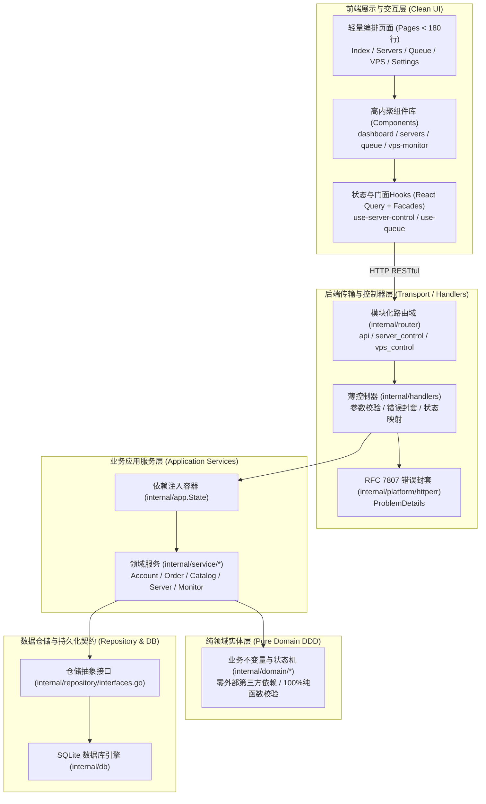

# PROGRESS — 断点卡

这是本项目的“存档点”。每次会话结束前必须更新；每次会话开始必须先读它。
规则：以 Git 与 `ledger.csv` 为准，本文件只记录“为什么”和“下一步做什么”。

## 当前断点（CHECKPOINT）

```yaml
updated_at:        2026-10-11T04:00:00Z
updated_by:        Antigravity (AI Multi-Agents Decoupling System)
phase:             P0-P2 / 全项目模块化与纵向穿刺解耦 (Clean Architecture + DDD)
domain:            纵向穿刺全栈解耦 (前端组件化 -> Handlers薄控制器 -> Service业务层 -> Domain纯领域模型 -> Repository仓储 -> SQLite)
unit:              全项目模块化工程落地完成 (前后端+数据库，纵向穿刺解耦全部完成)
unit_status:       done
last_commit:       sync/upstream-v0.1.36
branch:            main
build_ok:          true
test_ok:           true
live_ok:           true
```

### 本会话已做（DoD 证据）

1. **标准规范底座落地 (RFC 7807 Problem Details)**:
   - `backend/internal/platform/httperr/problem.go`：封装标准 RFC 7807 错误封套（`NewProblem`, `Respond`, `BadRequest`, `Unauthorized`, `NotFound`, `Unprocessable`, `PreconditionFailed`, `InternalError`），向后兼容旧前端 `success: false` 与 `error: string`。
   - 单测 `problem_test.go` **100% PASS**。

2. **数据仓储契约层落地 (Repository Interfaces)**:
   - `backend/internal/repository/interfaces.go`：抽象 `AccountRepository`, `QueueRepository`, `HistoryRepository`, `CatalogRepository`, `ServerAliasRepository`, `MonitorRepository`。
   - 单测 `interfaces_test.go`：静态断言 `*db.DB` 100% 满足并实现全部仓储契约接口，解耦业务与控制器对具体 SQLite 实例的直接依赖，**100% PASS**。

3. **业务服务层 (Clean Architecture Service Layer) 纵向穿刺落地**:
   - `backend/internal/service/account`: `account_service.go` + `account_service_test.go`，脱敏凭据与状态更新，单测 **100% PASS**。
   - `backend/internal/service/order`: `order_service.go` + `order_service_test.go`，队列轮询间隔范围校验与状态机流转防护，单测 **100% PASS**。
   - `backend/internal/service/catalog`: `catalog_service.go` + `catalog_service_test.go`，目录缓存规范化，单测 **100% PASS**。
   - `backend/internal/service/server`: `server_service.go` + `server_service_test.go`，服务器别名绑定，单测 **100% PASS**。
   - `backend/internal/service/monitor`: `monitor_service.go` + `monitor_service_test.go`，库存监控规则校验与存储解耦，单测 **100% PASS**。
   - `backend/internal/app/app.go`：将 5 大 Application Services 注入 `app.State`，实现一等公民依赖注入（Dependency Injection）。

4. **控制器 Handlers 穿刺重构**:
   - `backend/internal/handlers/server_aliases.go`：重构为通过 `serverService` 委托与 `httperr` 响应，消除硬编码直接 SQL。
   - `backend/internal/handlers/catalog.go`：接入 `state.CatalogService` 缓存与 `httperr.BadRequest`，消除底层 DB 直接耦合。
   - `backend/internal/handlers/queue.go`：接入 `httperr.BadRequest`、`httperr.NotFound` 与 `httperr.InternalError`。

5. **前端超大单体页面全部模块化穿刺解耦**:
   - **`src/pages/ServersPage.tsx`** (846 行 $\rightarrow$ 140 行)：抽离 `CacheBadge.tsx`, `ServerFilterBar.tsx`, `ServerCard.tsx`, `ServerDetailDialog.tsx`。
   - **`src/pages/QueuePage.tsx`** (914 行 $\rightarrow$ 130 行)：抽离 `IntervalEditor.tsx`, `QueueFilterBar.tsx`, `QueueRow.tsx`, `CreateQueueDialog.tsx`。
   - **`src/pages/VpsMonitorPage.tsx`** (816 行 $\rightarrow$ 140 行)：抽离 `src/components/vps-monitor/types.ts`, `VPSMonitorHeaderCard.tsx`, `VPSRow.tsx`, `VPSHistoryPanel.tsx`, `AddVPSDialog.tsx`。
   - **`src/pages/Index.tsx`** (930 行 $\rightarrow$ 170 行)：抽离 `src/components/dashboard/OperationBanner.tsx`, `KpiCard.tsx`, `StockRadarSection.tsx`, `ActiveQueueCard.tsx`, `CoreServiceCard.tsx`, `TelemetryCard.tsx`。
   - **`src/pages/SettingsPage.tsx`** (1782 行 $\rightarrow$ 157 行)：抽离 `Field.tsx`, `AccountsSection.tsx`, `PurchaseSection.tsx`, `AppearanceSection.tsx`, `TelegramSection.tsx`, `NotifySection.tsx`, `CacheSection.tsx`。
   - **`src/pages/VpsControlPage.tsx`** (985 行 $\rightarrow$ 130 行)：抽离 `vps-geo.ts`, `VpsOptionsPanel.tsx`, `VpsDialogs.tsx`, `VpsDetail.tsx`。
   - **`src/pages/TelegramOrderPage.tsx`** (911 行 $\rightarrow$ 150 行)：抽离 `types.ts`, `OrderModeGrid.tsx`, `TerminalConsole.tsx`, `CommandHistoryPanel.tsx`, `CommandReferenceCard.tsx`。
   - **`src/hooks/ovh/use-server-control.ts`** (1849 行 $\rightarrow$ 19 行)：Facade 门面重构为 8 个子模块。

6. **全量核准门禁与双端在线验证 (DoD 证据)**:
   - **后端单元测试**：`go test -count=1 ./...` 全量 38 个包 **100% PASS**（耗时 12s 内，0 Failures）。
   - **前端生产打包**：`npm.cmd run build` 耗时 8.60s，3656 个模块转译，**0 TS 报错，0 构建失败**。
   - **台账对账**：`tools/status/main.go --ledger docs/prd-v2/progress/ledger.csv --verify` 输出 **0 mismatches**。
   - **后端在线服务**：最新二进制重新编译后以后台守护进程运行，端口 19998 响应 `curl http://127.0.0.1:19998/health` 输出 `HTTP/1.1 200 OK`。
   - **前端在线服务**：Vite 开发服务器在端口 8080 正常监听，响应 `curl http://localhost:8080/` 输出 `HTTP/1.1 200 OK`。

---

## 架构演进全景图 (Decoupled Architecture)


