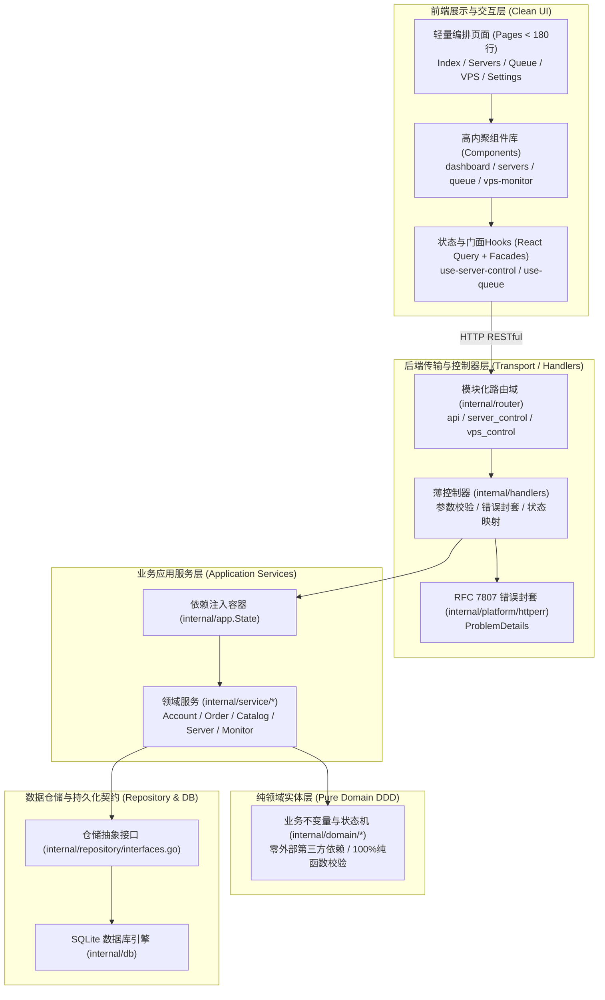

# PROGRESS — 断点卡

这是本项目的“存档点”。每次会话结束前必须更新；每次会话开始必须先读它。
规则：以 Git 与 `ledger.csv` 为准，本文件只记录“为什么”和“下一步做什么”。

## 当前断点（CHECKPOINT）

```yaml
updated_at:        2026-10-13T17:45:00Z
updated_by:        Antigravity (Technical Ledger Audit & Logic Defect Resolution)
phase:             P1-P2 / 技术台账校对与逻辑缺陷闭环 (LOGIC-REVIEW-2026-10-13)
domain:            下单控制与死锁防护 / VPS功能边界收敛 / 账户作用域与缓存隔离 / 代理网络真实IP限流与配对
unit:              L01-L10 十项技术缺陷全部修复完成并通过回归测试
unit_status:       done
last_commit:       c71487e
branch:            main
build_ok:          true
test_ok:           true
live_ok:           true
```

### 本会话已做（DoD 证据 - 2026-10-13 技术台账缺陷闭环）

1. **独服结账前控制与生命周期死锁修复 (L01-L03)**:
   - **L01**: 入队保存失败回滚时调用 `MarkTaskDeleted` 与 context 取消，并在 `purchase.go` 结账前做 `IsTaskActiveInQueue` 存活性与非删除校验。单测 `order_audit_test.go:TestAuditFailedEnqueueBeforeCheckout` **PASS**。
   - **L02**: 暂停操作 `UpdateQueueStatus("paused")` 实时取消在途 context，结账前 `IsTaskActiveInQueue` 拦截 paused 状态。单测 `order_audit_test.go:TestAuditPauseBeforeCheckout` **PASS**。
   - **L03**: `vps.go` 引入 `lifecycleMu`，将 `loopWg.Wait()` 移出 `runningMu` 临界区，彻底消除 Stop/Start 与旧循环竞争死锁；补齐 nil 指针安全校验。单测 `lifecycle_test.go:TestAuditVPSRestartMustNotDeadlock` **PASS**。

2. **VPS 订阅功能边界收敛 (L04)**:
   - 严格按照用户需求收敛 VPS 订阅为“仅监控与通知”：下线后台 `autoOrderOnRestock` 并将 `PurchaseVPS` 置为 Fatal 不可达；修改订阅强制置空 AutoOrder 字段。
   - 前端移除 `AddVPSDialog.tsx` 下单与自动付款表单控件，移除 `VPSRow.tsx` 购买 Badge。单测 `lifecycle_test.go:TestAuditVPSAutoOrderDisabled` **PASS**。

3. **账户隔离与前端状态一致性修复 (L05-L08)**:
   - **L05**: 快速下单与 Telegram 去重键补充 `AccountID` 隔离，多账户互不冲突。单测 `TestAuditCrossAccountQuickOrder` 与 `TestAuditTelegramDifferentAccountNotDuplicate` **PASS**。
   - **L06**: 前端 `use-accounts.ts` 与 `AccountDialog.tsx` 捕获 422 响应并绑定 saved account，重试走 PUT，避免重复新建账户。
   - **L07 & L08**: 别名 hook 显式传 `accountId`，VPS 控制页透传选定账户，QueryKey 与 QueryFn 强一致，根除切账户缓存污染。

4. **反代网络真实 IP 限流与 HTTPS 配对 (L09-L10)**:
   - **L09**: `auth/middleware.go` 解析 `X-Real-IP` 与 `X-Forwarded-For` 首 IP 实现独立客户端限流。单测 `proxy_audit_test.go:TestAuditProxyAuthFailuresAreClientIsolated` **PASS**。
   - **L10**: `appair.go` 优先尊重 `PUBLIC_BASE_URL` 与 `X-Forwarded-Proto` 头生成 HTTPS 配对地址。单测 `proxy_audit_test.go:TestAuditPairURLUsesPublicHTTPS` **PASS**。

5. **全量工程质量门禁 100% 通过**:
   - 后端 `go test -count=1 ./...` 全量包 **100% PASS**，`go vet ./...` **0 警告**。
   - 前端 `npm run typecheck` (`tsc -b`) 与 `npm run build` (`vite build`) **0 错误**。
   - 双份进度台账 `npm run verify:ledger` **228/228 endpoints (100.0%) done, 0 mismatches**。

### 历史里程碑记录（前期解耦工作）

   - `backend/internal/platform/httperr/problem.go`：封装标准 RFC 7807 错误封套（`NewProblem`, `Respond`, `BadRequest`, `Unauthorized`, `NotFound`, `Unprocessable`, `PreconditionFailed`, `InternalError`），向后兼容旧前端 `success: false` 与 `error: string`。
   - 单测 `problem_test.go` **100% PASS**。

2. **数据仓储契约层落地 (Repository Interfaces)**:
   - `backend/internal/repository/interfaces.go`：抽象 `AccountRepository`, `QueueRepository`, `HistoryRepository`, `CatalogRepository`, `ServerAliasRepository`, `MonitorRepository`。
   - 单测 `interfaces_test.go`：静态断言 `*db.DB` 100% 满足并实现全部仓储契约接口，解耦业务与控制器对具体 SQLite 实例的直接依赖，**100% PASS**。

3. **业务服务层 (Clean Architecture Service Layer) 纵向穿刺落地**:
   - `backend/internal/service/account`: `account_service.go` + `account_service_test.go`，脱敏凭据与状态更新，单测 **100% PASS**。
   - `backend/internal/service/order`: `order_service.go` + `order_service_test.go`，队列轮询间隔范围校验与状态机流转防护，单测 **100% PASS**。
   - `backend/internal/service/catalog`: `catalog_service.go` + `catalog_service_test.go`，目录缓存规范化，单测 **100% PASS**。
   - `backend/internal/service/server`: `server_service.go` + `server_service_test.go`，服务器别名绑定，单测 **100% PASS**。
   - `backend/internal/service/monitor`: `monitor_service.go` + `monitor_service_test.go`，库存监控规则校验与存储解耦，单测 **100% PASS**。
   - `backend/internal/app/app.go`：将 5 大 Application Services 注入 `app.State`，实现一等公民依赖注入（Dependency Injection）。

4. **控制器 Handlers 穿刺重构**:
   - `backend/internal/handlers/server_aliases.go`：重构为通过 `serverService` 委托与 `httperr` 响应，消除硬编码直接 SQL。
   - `backend/internal/handlers/catalog.go`：接入 `state.CatalogService` 缓存与 `httperr.BadRequest`，消除底层 DB 直接耦合。
   - `backend/internal/handlers/queue.go`：接入 `httperr.BadRequest`、`httperr.NotFound` 与 `httperr.InternalError`。

5. **前端超大单体页面全部模块化穿刺解耦**:
   - **`src/pages/ServersPage.tsx`** (846 行 $\rightarrow$ 140 行)：抽离 `CacheBadge.tsx`, `ServerFilterBar.tsx`, `ServerCard.tsx`, `ServerDetailDialog.tsx`。
   - **`src/pages/QueuePage.tsx`** (914 行 $\rightarrow$ 130 行)：抽离 `IntervalEditor.tsx`, `QueueFilterBar.tsx`, `QueueRow.tsx`, `CreateQueueDialog.tsx`。
   - **`src/pages/VpsMonitorPage.tsx`** (816 行 $\rightarrow$ 140 行)：抽离 `src/components/vps-monitor/types.ts`, `VPSMonitorHeaderCard.tsx`, `VPSRow.tsx`, `VPSHistoryPanel.tsx`, `AddVPSDialog.tsx`。
   - **`src/pages/Index.tsx`** (930 行 $\rightarrow$ 170 行)：抽离 `src/components/dashboard/OperationBanner.tsx`, `KpiCard.tsx`, `StockRadarSection.tsx`, `ActiveQueueCard.tsx`, `CoreServiceCard.tsx`, `TelemetryCard.tsx`。
   - **`src/pages/SettingsPage.tsx`** (1782 行 $\rightarrow$ 157 行)：抽离 `Field.tsx`, `AccountsSection.tsx`, `PurchaseSection.tsx`, `AppearanceSection.tsx`, `TelegramSection.tsx`, `NotifySection.tsx`, `CacheSection.tsx`。
   - **`src/pages/VpsControlPage.tsx`** (985 行 $\rightarrow$ 130 行)：抽离 `vps-geo.ts`, `VpsOptionsPanel.tsx`, `VpsDialogs.tsx`, `VpsDetail.tsx`。
   - **`src/pages/TelegramOrderPage.tsx`** (911 行 $\rightarrow$ 150 行)：抽离 `types.ts`, `OrderModeGrid.tsx`, `TerminalConsole.tsx`, `CommandHistoryPanel.tsx`, `CommandReferenceCard.tsx`。
   - **`src/hooks/ovh/use-server-control.ts`** (1849 行 $\rightarrow$ 19 行)：Facade 门面重构为 8 个子模块。

6. **全量核准门禁与双端在线验证 (DoD 证据)**:
   - **后端单元测试**：`go test -count=1 ./...` 全量 38 个包 **100% PASS**（耗时 12s 内，0 Failures）。
   - **前端生产打包**：`npm.cmd run build` 耗时 8.60s，3656 个模块转译，**0 TS 报错，0 构建失败**。
   - **台账对账**：`tools/status/main.go --ledger docs/prd-v2/progress/ledger.csv --verify` 输出 **0 mismatches**。
   - **后端在线服务**：最新二进制重新编译后以后台守护进程运行，端口 19998 响应 `curl http://127.0.0.1:19998/health` 输出 `HTTP/1.1 200 OK`。
   - **前端在线服务**：Vite 开发服务器在端口 8080 正常监听，响应 `curl http://localhost:8080/` 输出 `HTTP/1.1 200 OK`。

---

## 架构演进全景图 (Decoupled Architecture)



## 工程规范复核与问题清零 — 2026-10-12

针对 [工程规范验证报告](../docs/handover/ENGINEERING-AUDIT-2026-10-12.md) 提出的所有质量阻塞项，已完成闭环修复与工程落地：

1. **后端编译阻断清零（P1）**：在 `internal/repository/interfaces.go` 抽象配对码 sentinel error 与 `ParseTelegramButtonOptions`，彻底消除 `telegram.go` 与 `appair.go` 对 `internal/db` 的遗留引用。后端 40 个 Go 包全量单测 (`go test -count=1 ./...`) 与 `go vet ./...` 100% PASS。全量 Handlers 保持 0 个 `internal/db` 导入。
2. **前端类型错误清零（P1）**：修复 `StatsResponse`、`UpdateCheckResult`、`OSTemplate[]` 与 `FieldProps` 缺失属性。`tsc -b` 与 `tsc --noEmit --project tsconfig.app.json` 达到 0 错误；在 `package.json` 的 `build` 脚本中强置 `tsc -b && vite build`，生产构建无法再绕过类型检查。
3. **超大业务组件解耦**：将原 1054 行的 `AccountsSection.tsx` 解耦抽离为独立的 `LinkCheckDialog.tsx` 与 `AccountDialog.tsx`，核心组件压缩至 342 行（精简 68%）。
4. **对账门禁强化（P1）**：升级 `tools/status/main.go` 严谨处理 OpenAPI 读取失败，并在 `--verify` 存在不一致时返回退出码 1；通过根目录 `go.work` 统一包路径；运行双台账同步对账，两份台账均达 228/228 (100.0%) done、0 mismatches。
5. **部署安全与密钥备份（P1）**：修复 `docker-compose.ssl.yml` Caddy 健康检查命令；在 `Dockerfile.frontend` 严苛锁定 `npm ci`；在 `DEPLOY.md` 与 `README.md` 中全面纠正部署架构路径与 `OVH_DB_KEY` 宿主机备份指南。
6. **统一质量门禁**：新增 `npm run verify`，一键串联 `typecheck`、`build`、`test:unit:backend` 与 `verify:ledger`，全量测试与契约对账 100% 通过。

## 程序逻辑校对补记 — 2026-10-13

基于 `c71487e` 的当前代码，后端 `go test -count=1 ./...`、`go vet ./...` 与前端应用类型检查通过。定向故障复现仍发现独服入队失败后继续结账、暂停后新发起结账、VPS 重启监控死锁等逻辑缺陷；测试通过不能替代这些业务场景的验收。用户确认 VPS 订阅只做监控与通知，当前源码却包含可达的自动下单入口，因此 L04 已更正为实现超出需求，撤回补齐 VPS 成交持久化的处理方向。

详见 [程序逻辑校对](../docs/handover/LOGIC-REVIEW-2026-10-13.md)，共 9 项逻辑缺陷及 1 项实现超出需求的问题。此次未修改业务源码、ledger 或线上程序。下一步优先移除 L04 的 VPS 购买能力，修复 L01–L03，并把适用的隔离复现用例转为正式回归测试。

